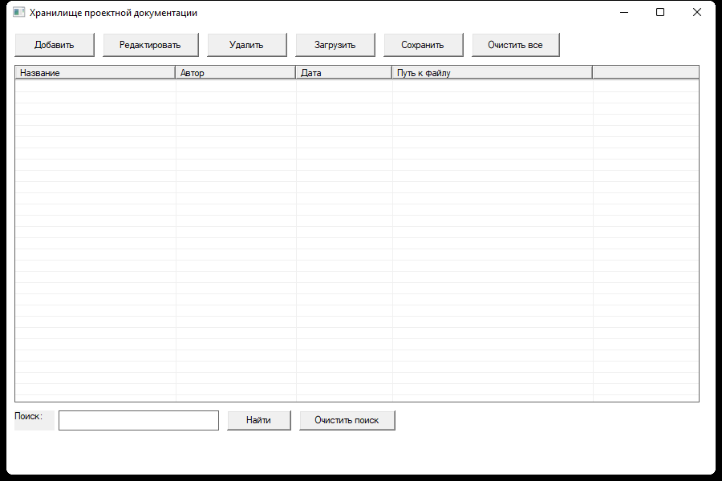
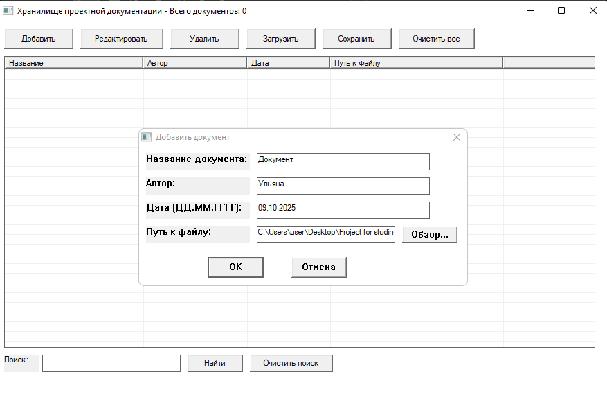
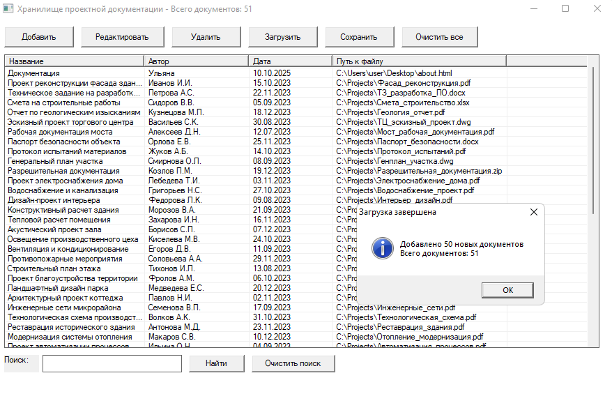
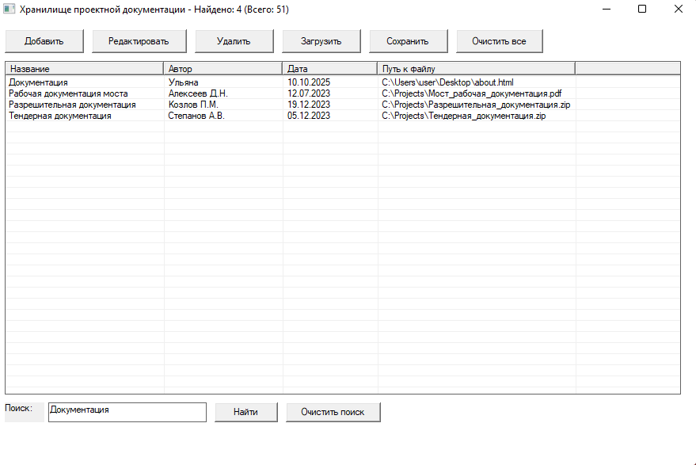
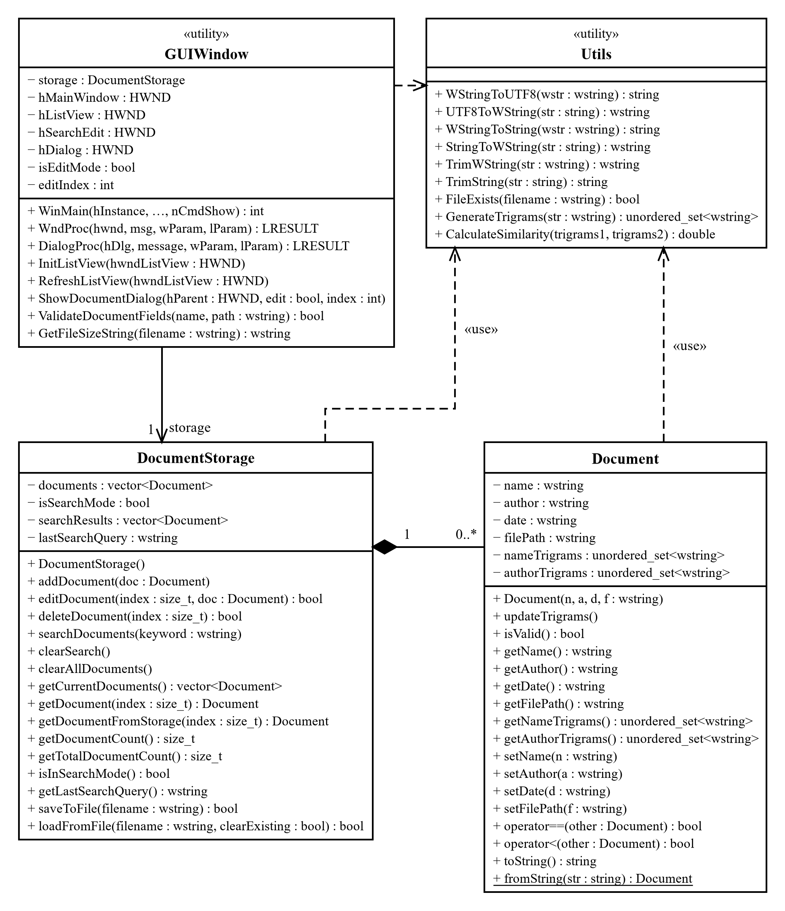
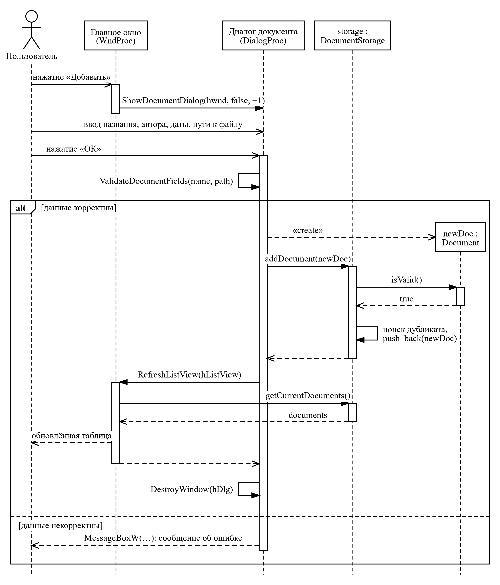
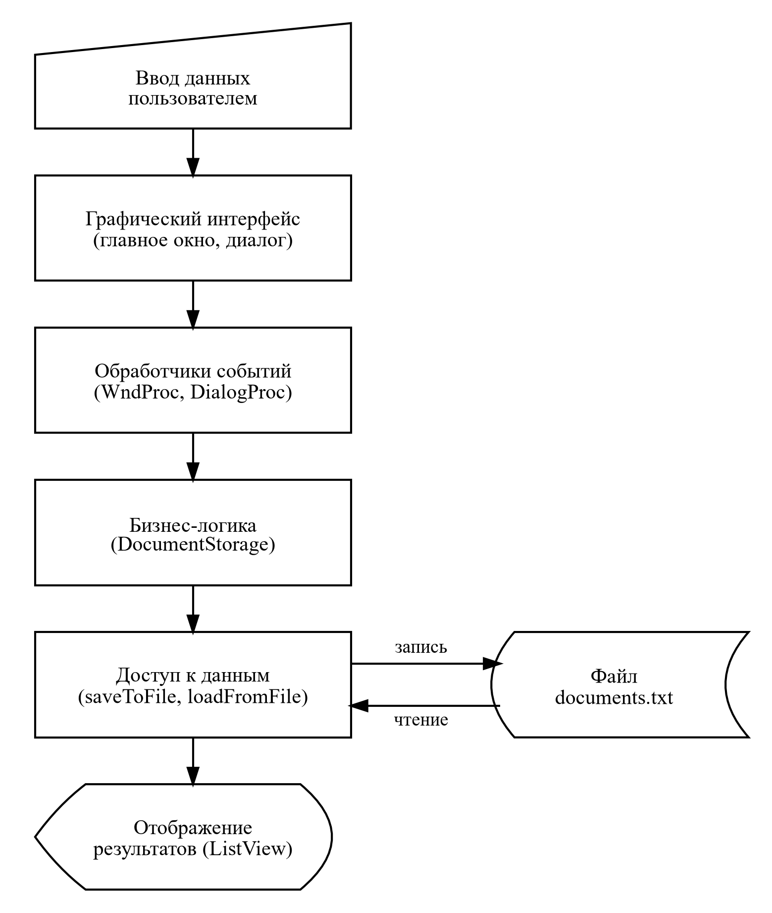
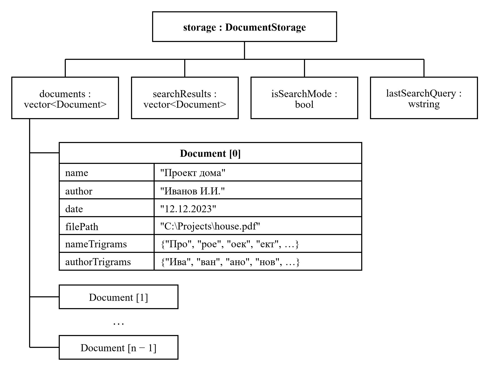

# 🏗️ Строительство: хранилище проектной документации

Курсовая работа по дисциплине **«Программирование»** (ТулГУ, Институт прикладной математики и компьютерных наук, 2025): прикладной программный продукт **«Строительство. Хранилище проектной документации»**.

Настольное приложение для Windows, в котором строительная организация ведёт реестр проектной документации — чертежей, смет, технических заданий, разрешительных документов: название, автор, дата и путь к файлу. Быстрый **триграммный поиск** находит документы даже по части слова. Написано на C++17 с чистым Windows API (Unicode), без сторонних библиотек; разработано, собрано и отлажено в **Code::Blocks**.

**Автор:** Фураев Владислав

## ✨ Возможности

- **Документы**: добавление, редактирование и удаление в диалоговом окне с проверкой полей (обязательные название и путь, существование файла) и выбором файла через стандартный диалог «Обзор»;
- **Поиск**: триграммный поиск по названию и автору — находит документ по фрагменту слова и при неточном вводе; результаты показываются в той же таблице, в заголовке окна — сколько найдено из общего числа;
- **Хранение**: сохранение реестра в файл `documents.txt` и загрузка из него — с заменой текущего списка или добавлением к нему; подтверждение перед перезаписью и перед удалением всех документов;
- **Интерфейс**: таблица `ListView` с колонками «Название», «Автор», «Дата», «Путь к файлу», панель кнопок, строка поиска.

| Добавление документа | Реестр из 51 документа | Поиск |
|---|---|---|
|  |  |  |

## 🧩 Устройство программы

Вся программа — один файл [`main.cpp`](main.cpp) (1169 строк).

| Компонент | Назначение |
|---|---|
| `Document` | документ: название, автор, дата, путь к файлу и набор триграмм для поиска |
| `DocumentStorage` | хранилище: добавление, изменение, удаление, триграммный поиск, сохранение в файл и загрузка |
| окно и диалоги Windows API | главное окно с таблицей `ListView`, диалог документа, обработка сообщений |

**Триграммный поиск.** Каждая строка разбивается на тройки соседних символов («Проект» → «Про», «рое», «оек», «ект»); триграммы названия и автора вычисляются заранее и хранятся в документе. Сходство с запросом — коэффициент Жаккара: доля общих триграмм среди всех. Документ попадает в результат, если сходство не меньше 30 % или запрос входит в название или фамилию автора как подстрока — поэтому поиск находит документ и по фрагменту, и при опечатке.

Схемы выполнены в чёрно-белом исполнении: диаграммы классов и последовательности — в нотации UML 2, схема потока данных — символами ГОСТ 19.701-90.

| Диаграмма классов | Последовательность добавления документа |
|---|---|
|  |  |

| Поток данных | Структура данных в памяти |
|---|---|
|  |  |

## 🛠️ Сборка и запуск в Code::Blocks

1. Установить [Code::Blocks](https://www.codeblocks.org/downloads/) с компилятором MinGW (сборка `codeblocks-…-mingw-setup`).
2. Открыть проект [`DocStorage.cbp`](DocStorage.cbp).
3. Выбрать цель **Release** (или **Debug** для отладки в GDB) и нажать **Build and run** (F9).

Готовая программа — `bin/Release/DocStorage.exe`; файл данных `documents.txt` создаётся рядом при первом сохранении. Настройки проекта: C++17, приложение с графическим интерфейсом (`-mwindows`), библиотеки `comctl32`, `comdlg32` и `gdi32`, статическая компоновка — программа запускается на любом компьютере с Windows 7 и выше без дополнительных библиотек.

## 📄 Документация

Пояснительная записка (76 страниц): анализ предметной области, техническое задание, проектирование классов, алгоритм триграммного поиска, описание программы, инструкция по эксплуатации, тестирование, листинг — [`docs/Пояснительная_записка.pdf`](docs/Пояснительная_записка.pdf) ([docx](docs/Пояснительная_записка.docx)).
